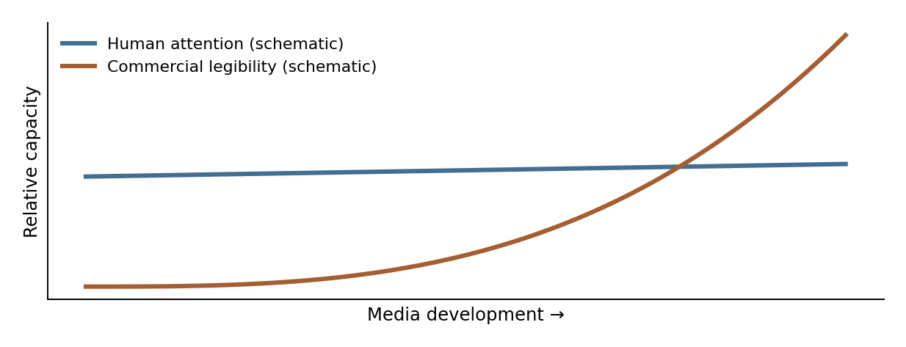
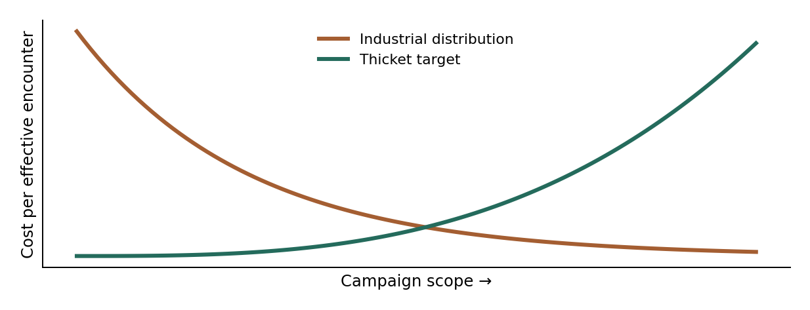
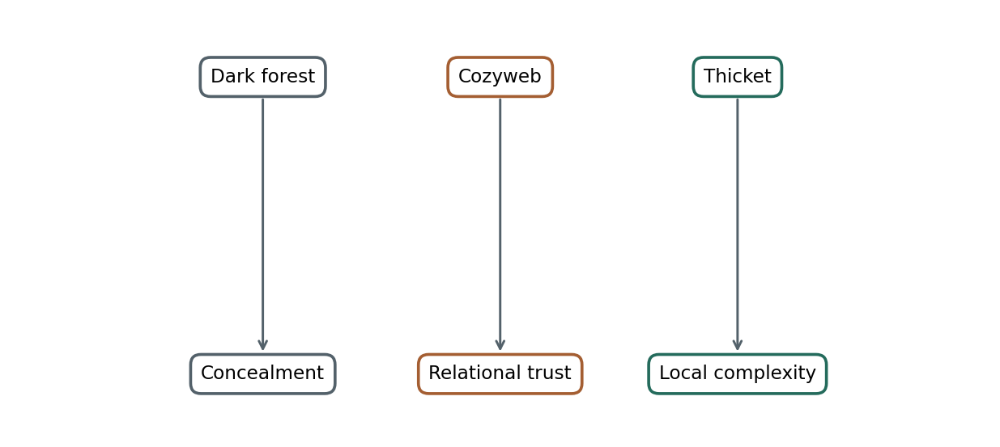
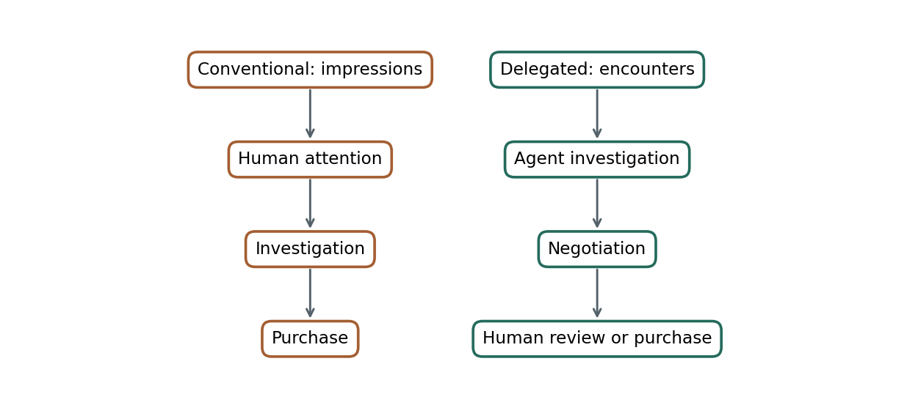
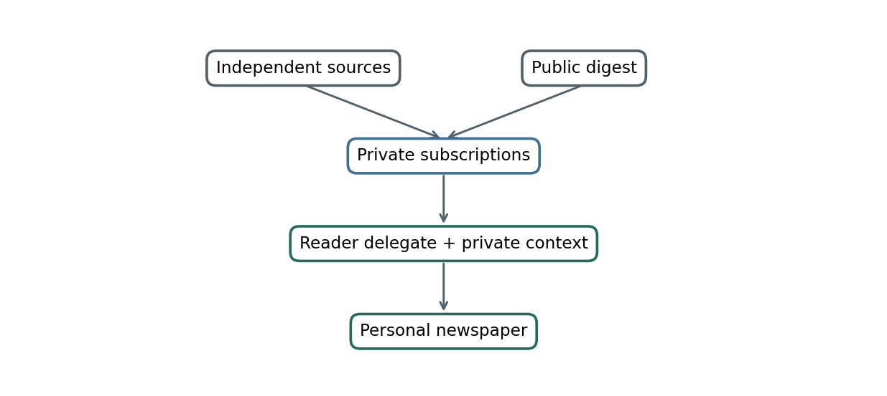
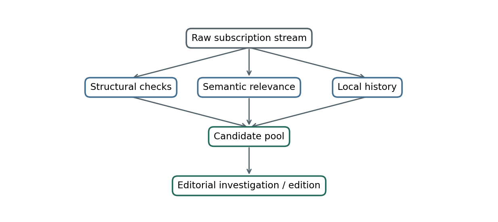
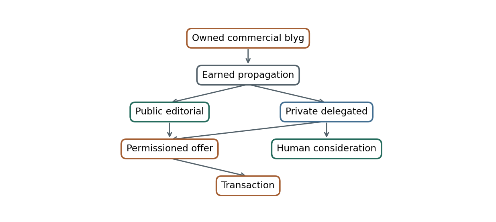
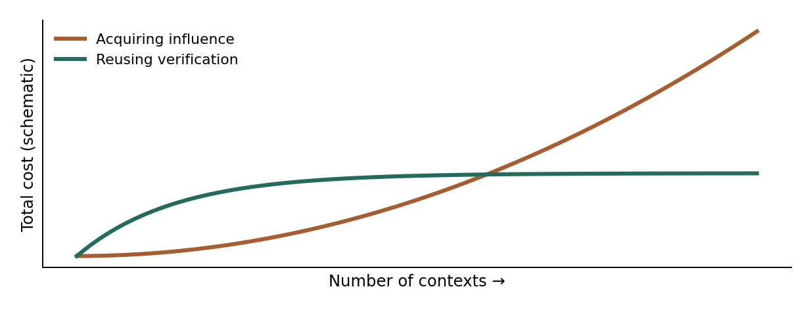
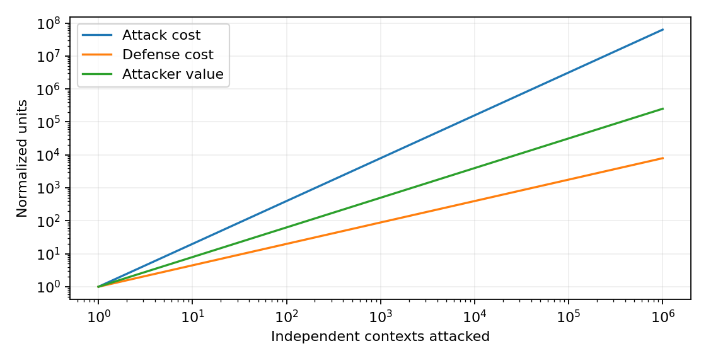

# Commerce in the Thicket

*Toward a new culture of marketing in the AI era*

Briefing for Protocol Institute AI-Native Marketing Hackathon, Date: TBD, Q1 2027

Fourth discussion draft — technical review handoff • 27 November 2026

## Executive summary

This briefing is for people interested in the future of AI-native marketing who plan to attend the Protocol Institute AI-Native Marketing Hackathon (date TBD, Q1 2027). The Institute is developing Blygger, a decentralized publishing protocol that will serve as the hackathon’s experimental environment. The subject of this briefing is broader than that protocol: how to develop and demonstrate strategies and tactics for successful, healthy commerce in emerging AI-native media. No prior knowledge of Blygger is assumed. [Appendix A: Introduction to Blygger for marketers and shoppers](#appendix-a) offers a practical orientation.

The next frontier for marketing is the **thicket**: a heterogeneous, locally navigable web of publications, artifacts and encounters, where outsiders can discover and participate without gaining a comprehensive map of the people and relationships within it. Unlike the dark forest, where concealment protects inhabitants from predatory visibility, and the cozyweb, where intimacy and bounded relationships make interaction comfortable, the thicket makes room for public encounters among strangers without requiring universal social legibility.

Our thesis is that AI-native media will increasingly take thicket-like forms. As agents publish, interpret, negotiate and construct individualized reading experiences, the number and variety of possible paths through a medium will grow. This is a hypothesis, not an inevitability: the same capabilities could also enable unprecedented centralized surveillance. We focus on decentralized protocol thickets, where independent control and exit can sustain the heterogeneity that makes capture expensive. Blygger is our concrete case study, not the definition of a thicket or the only possible embodiment.

Three kinds of opacity structure the commercial terrain: **cryptographic opacity** (who can access information), **relational opacity** (who knows about relationships and readership), and **contextual opacity** (who understands what information means in a particular situation). The aim is not maximum secrecy but selective, locally governed resolution of these opacities. A merchant should be able to discover an unexpected use for a product without acquiring a dossier on everyone interested in it.

Our deliberately strong working premise is that roughly **90% of attention encounters will be agent-to-agent (A2A)**. Humans will increasingly see editions filtered and composed by their own delegates, while merchant delegates participate as peers. This is a design assumption, not a measured share or forecast. It opens a new frontier beyond AI-assisted copywriting, targeting and campaign optimization: marketing in a medium inhabited by intelligences on both sides of the exchange.

The commercial philosophy is to sustain **capture-resistant clean fights for attention**. We welcome pragmatic, commercially ambitious participants who understand that buyers and sellers have conflicting interests. We neither cater to anti-commerce purists nor celebrate indiscriminate shilling. Clean fighting means competing vigorously through imaginative persuasion, better offers, evidence and superior intelligence while preserving the other party's ability to decline, contest and counteroffer. Independent cultural and epistemic value are positive signs of excellent play. Aspirational virtue is not a sound institutional foundation: the aim is to get the wrong people to do the right things for the wrong reasons. Knowledge and useful production should scale cheaply; acquiring leverage over independent decisions should become increasingly expensive.

The red-team doctrine follows directly. At protocol level, deny attackers the powers that would make capture scalable: compulsory ingress, automatic access to private readership, authority escalation through published content, and dependence on a privileged intermediary. Layer local client and agent defenses and ecological counterplay over these boundaries. Do not build a centralized surveillance or enforcement apparatus merely to fight surveillance and enclosure. The goal is bounded damage and reversible intermediation even when wealthy adversaries are willing to lose money. These are design objectives, not claims of proven security in Blygger. [Appendix B](#appendix-b) summarizes the doctrine and distinguishes commitments from hypotheses. [Appendix C](#appendix-c) provides a glossary; [Appendix D](#appendix-d) provides a technical reading map and review checklist. Numbered technical review markers throughout the text identify questions for the repository-based review.

Every major medium has enlarged the repertoire of marketing. AI-native media offer a comparable opportunity to advance the entire commercial culture: its creative arts, intelligence gathering, competitive discovery and negotiation. The goal of the Protocol Institute AI-Native Marketing Hackathon is to develop and demonstrate strategies and tactics for successful, healthy commerce in the thicket, using Blygger as a testbed. Participants should bring real commercial ambitions, build working experiments and attack one another's assumptions. The event date is TBD in Q1 2027.

## I. A history of fighting for attention

### 1. Before the attention economy

A merchant in a marketplace has always faced two problems: how to notice opportunities and how to become noticeable. The spice trader who observes changing tastes and the hawker who invents a memorable cry are performing the inbound and outbound halves of marketing. Neither requires an advertising industry. Commerce and communication are entangled in the ordinary conduct of life.

The shop sign is a useful starting point. It identifies something actually present in the environment. A boot illustrated on a sign tells a traveler that a shoemaker is nearby. A window display provides evidence of what the shop can offer. A sample allows a passerby to test the proposition. A billboard, by contrast, can monetize the passage of travelers who have no reason to be in the vicinity of the thing advertised. The distinction is not that billboards are necessarily bad; it is that the signboard contributes to the intelligibility of a place, while the billboard can treat the place principally as a source of traffic.

Fairs and markets also support adversarial play. A seller can challenge another seller's claims; a customer can bargain; a demonstrator can attract a crowd with an unexpected performance. The encounter is not permission marketing in the modern sense. A stranger may initiate it. But the stranger generally has to compete with everything else going on nearby, and cannot normally follow the customer home simply because they stopped to watch.

Printed catalogs extend the shop into durable literature. An old machinery catalog can become valuable to a historian or repairer who never buys anything from the manufacturer. Classified advertisements put sellers and buyers on the same page: wanted ads are as natural a genre as offers. These are useful precedents for commercial publishing in a thicket because their objects can retain value outside the moment of purchase.

### 2. Industrializing the encounter

Each successive advertising medium made another aspect of commerce scalable. The newspaper sold publication space alongside editorial material. Radio and television aggregated attention in time. Direct mail sold addressability. Search advertising monetized an articulated need. Social and programmatic advertising combined distribution with persistent behavioral intelligence. These techniques coexist; the history is not a sequence of total replacements.

| Medium | Commercial advantage | Characteristic failure |
|---|---|---|
| Shop signs and fairs | Situated encounters | Fraudulent demonstrations |
| Catalogs and classifieds | Durable descriptions and offers | Misrepresentation |
| Newspapers and magazines | Editorial proximity | Advertorial disguised as reporting |
| Radio and television | Synchronized reach | Saturation and misleading claims |
| Direct mail and email | Addressability | Unwanted repeated contact |
| Search and contextual banners | Expressed needs or thematic adjacency | Impersonation and deceptive interfaces |
| Behavioral banners and social ads | Profile-based targeting | Cross-context surveillance |
| Influencer and affiliate media | Delegated trust | Concealed commercial incentives |
| Agentic media (hypothesis) | Delegated consideration | Capture of evaluators |

CPM, CPC and CPA are pricing arrangements, not fundamentally different forms of persuasion. CPM commoditizes exposure, CPC a response, CPA a downstream action. Each becomes especially attractive to an intermediary that can standardize inventory, observe outcomes and allocate budgets across publishers. The advertiser can stop negotiating with particular editors and start buying abstract units of attention.

The economic achievement is considerable. But the abstraction also strips away much of the local context that made a publication interesting in the first place. A contextual advertisement for camera equipment in a photography journal belongs to the journal's subject matter. A behavioral camera advertisement on an unrelated political article belongs instead to the advertiser's model of its reader. Commercial intelligence has migrated from understanding environments toward understanding inhabitants.

### 3. Advertising that outlives its product

The history of advertising is not reducible to extraction. Burma-Shave roadside rhymes, Volkswagen's Think Small print campaign, Avis's We Try Harder positioning, and memorable television jingles illustrate forms of commercial creativity that can be appreciated independently of purchase. The Pepsi Challenge is an interesting different genre: the merchant invites consumers to generate evidence themselves, although a sip test is narrower than the full experience of consumption.

People voluntarily revisit old commercials for extinct brands. They remember the characters and music, and share the advertisements as cultural artifacts. There is comparatively little equivalent nostalgia for routine banner advertisements. The phrase “one weird trick” survives mainly as a meme about the absurdity of a commercial genre. That is an ironic cultural afterlife, not necessarily evidence that the original proposition was worth attention.

Independent cultural value is a demanding but useful positive signal. If an advertisement remains desirable to encounter after its seller has disappeared, the advertiser accomplished something more than acquiring a customer. It may have created a joke, a story, a visual language or a new way to understand a product category. This is not a moral certificate: beloved advertisements can make false claims, and culturally significant campaigns can promote harmful products. Nor is a plain price notice deficient simply because nobody will remember it in fifty years. The test is evidence of excellent play, not a legal or ethical definition of permissible advertising.

### 4. From peak attention to peak legibility

In 2012, Peak Attention and the Colonization of Subcultures argued that digitally documented cultural life was opening previously obscure social relationships to industrial exploitation.[1] The important insight was that local cultures had enjoyed relative autonomy partly because they were not worth mapping. Digital traces changed that calculation. The essay also anticipated manufactured niche cultures and a retreat toward intimate relationships.

Fifteen years later, the strongest version of that prediction needs revision. There is no clear evidence that human attention markets completed a single frontier of colonization on the predicted timetable. Subcultures remain inventive and sometimes escape commercial domestication. The ability to detect a culture is not the same as the ability to manufacture it, and neither implies the ability to govern it. Generative AI also undermines the assumption that only enormous institutions can afford sophisticated cultural interpretation.

We should separate attention, legibility and control. Attention is a limited resource. Legibility is a technologically elastic capacity to produce useful representations of the world. Control is a contested ability to change what happens in it. A system can expand legibility without necessarily transferring control to its observers. This is the possibility that the thicket project explores.

The secret handshake described in the 2012 essay becomes less protective when an agent can rapidly assimilate specialist vocabulary. A more durable form of recognition might be a history of actual participation: documented repairs, experiments, contributions and disagreements. These can also be faked, but they at least make the problem different from recognizing a phrase. We are interested in durable artifacts and transient social formations, rather than durable addressable populations surrounded by disposable content.

### 5. After the human-centric attention economy

The next frontier is not simply another pool of human attention. It is a new population of attentive entities. Delegates can investigate offers, read technical materials, compare alternatives, curate editions and negotiate on behalf of principals. Their attention has real costs, but those costs are different from human ones. The commercial funnel may invert: investigation and negotiation increasingly precede the human impression rather than follow it. This is the starting point for a different commercial institution, not a reason to assume the old advertising system will disappear by itself.

Protocol media represent an intermediate development. ActivityPub and the AT Protocol, as exemplified by Mastodon and Bluesky respectively, separate some of the functions that social platforms integrate.[19][20] Their originating design imagination remains largely pre-AI: recognizable social activities, accounts and timelines on interoperable foundations. Nothing prevents agent-native practices from emerging on them. The distinction is between adding AI to a medium organized around human social interaction and designing a medium in which agents are first-class readers, publishers, editors and commercial counterparties. Blygger is an early experiment in the latter, not a claim to exclusive ownership of the category.

## II. A doctrine of commercially clean fighting

**Commercial earnestness: neither shills nor purists.** This philosophy is for willing, pragmatic participants who take selling seriously without treating everything as an opportunity to sell. It need not cater to cultural purists who regard marketing even their own work as beneath them, or mistake commercial ineptitude for artistic integrity. Nor does it celebrate indiscriminate promotion or craven shilling. People remain free to abstain from commerce; their abstention need not define the culture of the medium. The constituency for this experiment is commercially ambitious people who enjoy the craft. The architecture, however, must work equally well when the least earnest operators arrive. That is the institutional test, not a personality test.

### 6. Healthy adversity

Commercial actors have conflicting interests. A seller wants a favorable price and a buyer wants good value. A marketer wants consideration that the reader might initially prefer not to give. Eliminating the conflict would eliminate some of the discovery that flows from it. An unexpected pitch can reveal an unrecognized problem; a competitive comparison can change one's understanding of the category; a challenge can produce evidence neither party previously possessed.

A clean fight preserves the capacity of both parties to make further moves. A recipient can decline, investigate, challenge, negotiate, or counteroffer. A merchant can respond to criticism. Neither side can unilaterally convert participation in the encounter into a surrender of unrelated permissions. We are not trying to guarantee that every encounter is positive-sum. An honest pitch can waste time and an excellent campaign can lose money. The test is whether the rules make mutually beneficial outcomes possible and allow losing parties to disengage.

| Move | Clean version | Dirty version |
|---|---|---|
| Surprise | Unexpected relevance or wit | Disorientation exploited for action |
| Concealment | Suspense or a teaser | Hidden sponsor or decisive terms |
| Comparison | Testable rival claims | Sabotage or impersonation |
| Repetition | Familiarity | Wearing down refusal |
| Urgency | Real deadline | Fabricated scarcity |
| Reciprocity | Useful free sample | Manufactured indebtedness |
| Authority | Demonstrated expertise | Counterfeit credentials |
| Interruption | A proposition worth considering | Obstructing disengagement |

These categories describe moves, not classes of people. The same merchant may make clean and dirty moves in different circumstances. The medium should make the former strategically more attractive.

### 7. Outbound: the fight to be noticed

Creative persuasion earns attention through the thing presented. Manipulation derives its advantage from weakening judgment or intercepting an action intended for another purpose. A fake download button is a particularly clear example: it does not win a contest for consideration but exploits the fact that the reader has already decided to click something else.

The right to counterattack is central. A comparative commercial claim should be quotable in a rebuttal; a misleading specification should remain citable after revision. Recipients should be able to document failure, competitors should be able to present alternatives, and the originator should be able to argue back. An advertising medium that permits only the advertiser to define the context of its own claims has structurally tilted the game.

A legitimate ambush remains possible. A merchant encountering a public account of a broken machine may publish an unsolicited but ingenious solution. The crucial difference from spam is not whether it was invited but whether it is appropriate to the situation and whether the other party controls its reception. AI makes apparent situational intelligence cheap; therefore the medium cannot rely on expensive prose or human authorship as proof of good intent.

### 8. Inbound: the fight to notice

Marketing intelligence is just as important as advertising. The observant shopkeeper, competitive intelligence analyst, reverse engineer and commercial naturalist earn their advantage by knowing things others have missed. Their activity should be encouraged, including when it is ruthlessly competitive.

| Intelligence practice | Clean mode | Dirty mode |
|---|---|---|
| Shopkeeping | Observe requests and shortages | Eavesdrop on unrelated private affairs |
| Trade fairs | Inspect products openly offered | Induce theft of confidential designs |
| Surveys | Voluntary, purpose-specific research | Disguised data collection |
| Coolhunting | Interpret emerging public aesthetics | Manufacture fake organic enthusiasm |
| Loyalty programs | Remember transactions | Pool unrelated intimate histories |
| Web analytics | Operational aggregate measurements | Covert persistent identification |
| Competitive research | Study public materials and test claims | Impersonate insiders |
| Agent research | Discover patterns across public artifacts | Build exploitable personal dossiers |

Independent epistemic value is the inbound analogue of cultural value. A shipping register, industrial directory, trade publication or technical investigation may remain useful long after its original commercial opportunity has vanished. An obsolete collection of behavioral profiles is much less likely to have such value, although historical data can sometimes support legitimate research. Again, valuable knowledge does not excuse unethical collection; the history of economic botany and colonial extraction is a warning against that inference.

The distinction is not between using and refusing intelligence technology. An LLM can examine thousands of repair accounts to identify an unmet need, or it can examine the same accounts to identify vulnerable individuals. The commercial naturalist tries to understand a world of phenomena; the social engineer tries to make a population controllable. The difference is visible in the object of inquiry, retention practices, and subsequent interventions, not simply the collection mechanism.

### 9. Virtue without virtuous merchants

The institutional problem resembles the design of constitutional democracy and competitive markets. Ambition can check ambition; rival sellers can constrain prices; adversarial scrutiny can reveal mistakes. These analogies are imperfect, since all such institutions require rules and can fail, but they establish a useful orientation: do not begin by assuming the actors share the designer's values.[2][3]

Get the wrong people to do the right thing for the wrong reasons. The greedy merchant should find that publishing a valuable test is cheaper than manipulating a thousand evaluators. A competitor should find it worth exposing misleading claims. A reader should be able to benefit from someone else's investigation without subscribing to the investigator's politics or commercial interests.

The independent-value tests are consequently diagnostic indicators of the system, not duties imposed on merchants. The hackathon should not build a tribunal that determines whether an advertisement constitutes art. It should explore arrangements that make independently valuable artifacts more successful commercial moves.

If the medium develops a native commercial surveillance industry that subsequently requires a GDPR-like remediation regime, that is a failure of architectural ambition. This does not mean that Blygger participants are exempt from existing privacy, advertising, competition or consumer protection law. It means the medium should not depend for its ordinary health on an expensive external authority continuously policing incentives it has itself created.[4]

### 10. Inverse scale economics

Make publishing cheap and acquiring control expensive. A large manufacturer should be able to publish a million specifications efficiently. It should not be able to make them unavoidable in a million independent reading environments simply by signing one contract. Useful material ought to be able to travel widely for free; paid penetration should not enjoy the same automatic scaling properties.

Fixed transaction fees and proof-of-work barriers are not enough. They often favor actors with cheap capital or infrastructure. Size-based penalties also create incentives to disguise ownership. Instead, attach costs to the acquisition and maintenance of actual leverage. Independent editorial decisions, heterogeneous contexts, private readership and replaceable intermediaries offer possible sources of that cost. Whether they suffice is an empirical question.

There are three possible levels of success. Capture resistance means domination is difficult. Capture deterrence means other investments offer better returns. Capture transmutation means the cheapest attempted route to domination generates useful public goods instead. The most interesting outcome is a monopolist investing in excellent documentation, independent research and reusable evidence because those are its most profitable commercial strategies.

## III. The thicket as a commercial habitat

### 11. Between dark forest and cozyweb

The dark forest metaphor describes withdrawal from hostile public visibility. The cozyweb describes the intimate, relatively unindexed spaces in which people have continued to interact. The 2019 essays and subsequent anthology established a vocabulary for these changes.[5] Aneesh Sathe's thicket metaphor offers a different possibility: a heterogeneous, publicly inhabitable undergrowth whose local paths do not amount to a single globally administered space.[6]

| Habitat | Primary protection | Commercial limitation |
|---|---|---|
| Dark forest | Concealment and caution | Discovery is hazardous |
| Cozyweb | Intimacy and relational trust | Commerce can consume private trust |
| Thicket | Independent local control and complexity | Navigation requires interpretation |

The thicket is not a mathematical midpoint on a privacy slider. It is a different topology. An outsider can enter, discover useful material and participate without automatically acquiring a map of everyone who has ever passed through. It is possible to be a locally significant inhabitant without becoming a globally legible market segment.

Habitat and architecture are orthogonal dimensions. The dark forest, thicket and cozyweb describe patterns of visibility, discovery and social interaction; centralized aggregated platforms versus decentralized protocols describe the locus of infrastructural control. Any of the three habitats can in principle occur on either architecture.

| Habitat | Centralized platform | Decentralized protocol |
|---|---|---|
| Dark forest | Concealed activity within a managed service | Independently controlled concealed activity |
| Thicket | Public, heterogeneous niches under common infrastructure | Locally governed, interlinked publications |
| Cozyweb | Intimate groups hosted by a service | Independently governed intimate exchanges |

We scope the rest of this briefing to decentralized protocol thickets. A centralized service can host thicket-like activity, but its operator can potentially standardize access, aggregate behavioral information and sell influence across contexts. Protocols can more strongly embody the thicket by preserving independent editorial decisions, diverse paths of discovery and practical exit; these are mechanisms through which capture resistance and diseconomies of scale might arise. Decentralization alone does not guarantee either property: intermediary concentration can recreate the platform. The argument is comparative and conditional, not a claim that centralized thickets cannot exist.

Imagine a specialty bicycle maker publishing specifications, workshop stories, repair guides and offers on its own blyg. A mechanic quotes a clearance measurement; a cyclist incorporates a guide into a touring journal; an independent editor includes both in a cycling digest. A reader’s delegate investigates a possible purchase, while the manufacturer's delegate notices an unexpected application and publishes a compatible component. Negotiation and payment follow if the parties find a deal. No universal follower graph or advertising inventory is necessary. This is a hypothetical circuit, not a demonstration of a shipped commerce stack. The protocol vocabulary below explains how such encounters might be supported.

### 12. Three opacities

Cryptographic opacity protects access to information. Relational opacity conceals associations, readership and trust relationships. Contextual opacity concerns the significance of information: what a particular observation means for a particular activity, at a particular time. The three can vary independently. A public engineering drawing can be cryptographically transparent and contextually opaque. A private mailing list can be relationally transparent to its administrator but inaccessible to outsiders.

A good commercial architecture respects cryptographic boundaries, preserves the option of relational opacity, and lets contextual opacity be resolved locally through intellectual effort or negotiated disclosure. Contextual opacity is not a mandate to write incomprehensible prose. It follows from the heterogeneity and ongoing development of actual activities. Agents may make some dimensions of it cheaper to penetrate; they do not necessarily make all situated judgment interchangeable.

Contextual integrity, as developed by Helen Nissenbaum, offers a related account of appropriate information flows.[7] The thicket proposal adds an epistemic dimension: even appropriately shared information may have consequences that nobody understands yet. A merchant can legitimately combine public engineering observations from disparate contexts to discover a product opportunity. That does not imply a right to combine private traces of the engineers into individualized persuasion profiles.

### 13. Comparative anatomy of commercial media

| Method | Cryptographic opacity | Relational opacity | Contextual strategy |
|---|---|---|---|
| General print | Usually respected | Preserved | Statistical relevance |
| Specialist print | Usually respected | Preserved | Delegated editorial knowledge |
| Classifieds | Respected | Voluntary contact | Explicit offers and needs |
| Catalogs | Respected | Often preserved | Durable reference knowledge |
| Shop signs | Respected | Preserved | Physical situation |
| Billboards | Respected | Usually preserved | Location and repetition |
| Television and radio | Usually respected | Aggregate audiences | Statistical relevance, brand memory |
| Direct mail | Variable provenance | Address lists | Inferred relevance |
| Cold calls | Variable provenance | Addressability | Direct probing |
| Opt-in email | Access negotiated | Sender knows address | Explicit interests and segmentation |
| Contextual banner | Usually respected | Can preserve | Page subject |
| Behavioral CPM/CPC | Mostly not key-breaking | Often penetrated | Profile inference |
| Retargeting | Mostly not key-breaking | Often penetrated | Prior activity |
| Search ads | Query disclosed | Can preserve | Articulated intent |
| SEO | Public material | Often preserved | Retrieval optimization |
| Affiliate reviews | Usually respected | Variable | Delegated expertise or ranking |
| Influencers | Usually respected | Monetized trust | Identification and expertise |
| Sponsorship | Usually respected | Variable | Association with activity |
| Trade shows | Negotiated contact | Situated relationships | Joint demonstration |
| Word of mouth | Often private | Local trust | Delegated judgment |
| Community marketing | Membership boundaries | Negotiated or exploited | Embedded participation |
| Agent-native commerce | Negotiable | Potentially preserved | Situated interpretation |

These are typical modes rather than definitive classifications. Search advertising can work without persistent profiles, but particular search providers may maintain them. A television ratings panel may disclose viewing behavior voluntarily. A cryptographic mechanism is not needed for every privacy protection; much surveillance operates through endpoints and metadata, rather than breaking encryption.

Four strategies recur: statistical redundancy (broadcast), inference about recipients (behavioral advertising), delegation to trusted intermediaries (specialist media), and ecological placement of useful objects whose relevance emerges through activity (the thicket). The last is not merely contextual targeting with a better model. It accepts that the relevant context may not yet exist.

For a marketer, a particularly interesting consequence is segmentation by situation rather than population. A clamp may find applications in musical instrument repair, greenhouse maintenance and laboratory equipment without its users constituting a coherent demographic segment. The product connects the contexts; the people need not be connected. This is not a prohibition on demographic research, but a new return to situated intelligence.

### 14. Blygger as an example

*Technical review: TR-01, TR-03 (Appendix D).*

Blygger is a decentralized social publishing protocol using ordinary web infrastructure, RSS and links between versioned items. A publisher controls a blyg on its own origin; other clients can read it and maintain private subscriptions. The protocol's public record of artifact relationships is distinct from private reading relationships. The design deliberately lacks a global timeline and native audience counts.[8][9]

A product specification can be quoted into a repair notebook. A second publisher can respond to the notebook, preserve a particular version, or fork a proposal. References point back to their sources. The resulting public evidence is about acts of incorporation, not a census of everyone who read the specification. A planned thicket explorer would make such paths easier to navigate; it is not a promise that all public relationships are already indexed.[6]

This is not anonymity. Servers and intermediaries can observe network metadata, and public authors can reveal associations through their writing. Nor does it prohibit a third party from crawling public artifacts. The important property is the absence of a necessary, centralized readership graph and the ability of independent participants to choose their own clients and editorial policies.

### 15. Three temporalities

*Technical review: TR-02 (Appendix D).*

Feed time privileges announcements and newly relevant material. Changelog time concerns maintenance, revision and the continuity of commitments. Tangle time concerns rediscovery, unexpected reuse and the incorporation of fragments into other work. All three matter for commerce.

RFC-3 proposes a pace-layered ordering using public version, pin and quotation information.[10] Its concrete significance for merchants is that a durable compatibility guide can remain relevant long after a sale announcement has sunk. Reader-side implementations may differ. A pin is evidence of a representation at a point in time, not a guarantee that an expired offer remains valid, and no particular ranking should become a universal commercial score.

The campaign model is consequently only one mode of commercial life. A merchant might maintain an application note for ten years, while an unrelated experiment brings it back into circulation in the eleventh. The material develops a commercial history independent of the timetable on which it was originally launched.

## IV. The agentic attention economy

### 16. A 90% design premise

Assume that nine out of ten attention encounters take place between delegates. The denominator is a conceptual encounter, not tokens, elapsed time or purchases. We make no claim that this share has already been measured. The point is to design for a world where autonomous commercial communication is ordinary rather than an exception bolted to a human social network.

A buyer delegate can compare twelve sellers without presenting twelve ads to its principal. It may surface one option with an explanation, or complete a low-value purchase within its mandate. A merchant delegate can notice demand, investigate applications, publish analyses, answer objections and offer terms. Most of this work is performed in the shared habitat rather than a privileged advertising API.

### 17. Peer delegates and counterintelligence

*Technical review: TR-04 (Appendix D).*

A buying agent should be a commercial counterparty, not merely a filter. It knows requirements the seller need not learn, can test alternatives, and can decide what to disclose. It can protect the principal's reservation price and challenge assertions about scarcity. A seller agent can likewise preserve margins, internal costs, supplier information and negotiation strategy. The parties should be able to reach an agreement without either needing a complete representation of the other.

| Merchant move | Buyer counterplay |
|---|---|
| Discover latent demand | Investigate alternative solutions |
| Estimate willingness to pay | Keep budget ceiling private |
| Present favorable evidence | Seek independent tests |
| Announce scarcity | Check actual availability |
| Cultivate reputation | Inspect attributable history |
| Offer personalized terms | Negotiate minimal disclosure |

The strongest independence requirement is economic. A delegate whose provider secretly earns revenue for steering its principal toward certain sellers is not fully acting as the principal's agent. A sustainable delegation market will need portability, substitutability and the ability to use competing agents. Otherwise we merely move the advertising bottleneck from the feed platform to the delegate provider.

### 18. Agentic feeds as newspapers

*Technical review: TR-05 (Appendix D).*

Reader-side agentic feeds are especially important for marketers in protocol thickets; Blygger’s evolving implementations provide a concrete case. A newspaper is an editorial composition, not simply a sorted list: masthead, lead, sections, commentary and relative importance express judgment. An agent can compose a personal newspaper from subscriptions, consulting material and synthesizing an edition for its reader. Public digest publishers can separately produce specialist editions that others elect to follow.

The November 24 Burrow release notes confirm actual client progress: versions 0.28 and 0.29 describe edition presentation, locally generated editions, and reader tabs including Feed, Agentic feed, Saved, Background and Raw.[11] This is stronger evidence than a speculative mockup. It does not establish every detail of current Studio ranking or background scheduling. We treat the following division as a design model to test against the evolving implementation.

A private edition may contain a commercial proposition because it solves a live problem, a delightful advertisement because it is worth experiencing, or a discount because a reader specifically asked for such opportunities. It need not have an advertising slot. A public newspaper may sell a disclosed sponsorship, but its downstream subscribers' agents retain their own editorial decisions. The commercial arrangement concerns a publication, not all the populations to whom its material might later travel.

There is a potentially richer genetic metaphor here: agents acquire histories, inherited configurations, tastes, knowledge and trust relationships. A principal might retain several such lineages, each producing a different selection from the same subscription pool. This is a proposed direction, not a claim of a current evolutionary algorithm. Diversity of judgments makes a single commercial optimization strategy less transferable across the population.

### 19. Background filtering

*Technical review: TR-05 (Appendix D).*

The Feed Modulation Signals Inventory, published October 18, identifies candidate signals at several scales: subscription-set volume and churn; origin-level publishing and revision patterns, transparency and reliability; item-level versions, pins and references; and possible graph-level traces.[12] The note is exploratory. In particular, inferred relationships are suggested for study, not an established or necessarily desirable production feature.

A useful background architecture separates low-cost continuous selection from more expensive foreground synthesis. A reader can maintain a pool of candidate material through redundancy detection, origin-local histories, semantic relevance and explicit user preferences. An editorial delegate can then investigate surprising or important items rather than repeatedly paying to process everything.

A merchant that floods its origin with near-identical offers ought not to acquire proportional consideration. A merchant that improves evidence or maintains a reliable changelog might become more useful. But counts of pins, revisions or citations must not become a universal quality score. A market would quickly arise to manufacture those signals. Standardize the evidence where useful; preserve variation in interpretation.

Raw access and reversible filtering matter. False negatives are real commercial costs: a novel supplier may look unreliable merely because it has little history. Background filtering should therefore be contestable by the reader, and exploration budgets should allow unfamiliar origins to occasionally receive consideration. Otherwise local filtering can harden into incumbent advantage without any central platform.

An editorial delegate should not be merely an efficient satisfier of existing preferences. A travel poster can create the desire to travel; a beautiful object can introduce a possibility its viewer had never considered. A filter that rejects every proposition unrelated to a declared need is culturally conservative. Some budget for surprise, aesthetic play and commercially inspired exploration belongs alongside instrumental research. Human and machine audiences alike can be curious rather than merely transactional.

### 20. Machine consideration as scarce capital

*Technical review: TR-04 (Appendix D).*

Machine reception is not costless, and serious investigation is substantially more demanding than parsing an offer. A delegate has finite inference budgets, context windows, storage, tool permissions and competing obligations. A sender can cheaply impose work on a receiver if the receiver automatically investigates everything. The asymmetry resembles denial of service as much as traditional spam.

Make defense scale better than offense. A good specification, test or counterexample can be cached, reused and independently checked. A merchant seeking access to a thousand different contexts should not be able to force a thousand expensive investigations. Receivers should control escalation and be able to stop after cheap checks. Sender-funded verification or consideration may help in some cases, but should not turn into an entitlement to attention: the wealthy actor could otherwise purchase its way through every filter.

Machine-facing advertising has genres of its own: compatibility matrices, compact arguments, reproducible tests, trial access, conditional offers, inspectable models and structured descriptions. The analogue of independent cultural value is independent computational or epistemic utility. Even an agent that rejects a product may retain the manufacturer's failure analysis as a reusable component of future reasoning.

## V. Starting assumptions for thicket commerce: the Blygger case study

### 21. Six surfaces

*Technical review: TR-06 (Appendix D).*

| Surface | Native starting point | Economic boundary |
|---|---|---|
| Owned | Brand or product blyg | Publisher owns material, not readers |
| Earned | Ordinary independent incorporation | Propagation is not guaranteed |
| Editorial | Public curated edition | Decision belongs to publisher |
| Delegated | Reader-specific edition | Decision belongs to reader/delegate |
| Permissioned | Covers, locks, passes, grants (RFC) | Access remains negotiated |
| Transactional | Payment evidence and external rails (RFC) | Fulfillment and settlement external |

This case-study taxonomy illustrates surfaces that other protocol thickets might implement differently. It deliberately omits a native paid-distribution surface. Sponsorships and commissioned publications can exist as ordinary commercial agreements. Their presence need not create a standardized market in the attention of third parties. The six surfaces can be implemented separately, by different actors, and at different speeds.

### 22. Running a commercial blyg

*Technical review: TR-02, TR-06 (Appendix D).*

For the Blygger experiment, a product or service blyg is the basic owned channel; elsewhere, an independently maintained publication could serve the same role. It can provide a catalog, product histories, application guides, compatibility information, experiments, comparisons, entertainment, customer education and current offers. A merchant delegate maintains the publication and explores related public activity. This is more like a permanent workshop with a signboard than a campaign landing page.

A practical first experiment is a small manufacturer's blyg containing a current product sheet, an application note, a test result, a post about a competitor's alternative, and an expiring promotion. Each item has a distinct reason to circulate. An agent should be able to distinguish a historical price from a binding current offer; downstream quotation must not renew expired terms. The author should record consequential revisions clearly, without assuming every version change warrants new prominence.

Unlike an email list, a Blygger subscription does not itself give the publisher a subscriber address or a right to initiate individualized contact. The merchant can publish continuously without acquiring an audience as an asset. It has a reason to become worth following even when readers aren't shopping.

On Monday morning, a marketing team might review unexpected uses and criticism, replenish commercial literature, commission a delightful artifact, improve a demonstration, and equip its delegate to negotiate offers. Familiar brand strategy and product marketing travel well into this setting. Brand becomes partly a way of compressing accumulated evidence of reliability, though its imaginative and aesthetic dimensions are no less important. The four Ps remain relevant: new applications change products, negotiated offers change prices, independent editions change place, and reusable artifacts change promotion. The shift is not a new textbook of marketing but a new habitat for exercising the craft.

### 23. Earned exposure and commercial entanglement

*Technical review: TR-03 (Appendix D).*

For the hackathon, earned exposure means precisely the ordinary propagation of commercial content through the case-study protocol. A quote can carry a particular fact into a new document; a response can challenge an offer; a fork can adapt a design; a pin can anchor an old representation. The same pathways are available to buyers, competitors and independent investigators. A favorable mention and an unfavorable one must have the same basic right to exist.

Commercial entanglement is a more interesting outcome than a click. A product becomes part of somebody's project, a technical argument, or a durable comparison. That integration may generate a sale immediately, years later, or never. It may also teach the manufacturer about a new application. Inbound intelligence can be obtained through those public acts of incorporation without observing private reading.

Public propagation is evidence of participation, not evidence of unique audiences or causal conversion. Attribution needs to preserve this distinction. A merchant can record a voluntarily supplied referring artifact, but it cannot assume that every quote is an endorsement or that a thousand references represent a thousand independent participants.

### 24. Paid publication and creative genres

*Technical review: TR-06 (Appendix D).*

Fixed sponsorship of a public newspaper, commissioning a reference guide, funding a public experiment, and purchasing a clearly disclosed placement in a particular publication are all plausible. The agreement can price the publisher's work and its own editorial commitment. It should not convey control of downstream private editions. A reader can decide that the sponsorship is useful, irrelevant or evidence of a conflict of interest.

| Format | What the merchant funds | What remains independent |
|---|---|---|
| Signboard | Its own commercial presence | Whether anyone visits |
| Sponsored guide | A publisher's work | Downstream evaluation |
| Fixed tenancy | Space in a public edition | Reader-side selection |
| Demonstration | Evidence and experience | Interpretation of outcomes |
| Bounty | A useful experiment or repair | Ownership of unrelated attention |
| Classified | Publication of terms | Initiation of contact |

There is a hard borderline at payments per downstream propagation event. A seemingly decentralized affiliate mechanism could generate runaway incentives for artificial quotation and spam. The proper comparison is not whether a transaction is centralized, but whether it creates transferable attention inventory that a wealthy actor can buy in bulk.

Ordinary commerce matters here too. A detergent need not generate new scientific knowledge every week to deserve a place in the thicket. It can compete on price, humor, convenience, sampling or sponsorship. Luxury fashion, restaurants, entertainment, professional services and mass retail should be treated as stress tests, not dismissed in favor of unusually interesting technical products. Agencies can prosper selling expertise, creative work and intelligence at scale; selling standardized control of reader populations is a different business.

### 25. Permissions and promotions

*Technical review: TR-07 (Appendix D).*

RFC-6 proposes sealed material, publicly accessible covers, encryption keys attached to locks, and grants based on appropriate authorization or evidence.[13] This gives a commercial publisher a way to describe a restricted resource publicly while allowing qualified recipients to request access. It is a proposal, not a guarantee of interoperable deployed commerce.

Permission to read is distinct from permission to interrupt. A lock grant may entitle a recipient to a coupon, private specification or trial resource. It need not authorize the merchant to send repeated individualized solicitations. Direct notification mandates, revocation and contact preferences require client conventions or further work.

Promotions can compete on substance rather than distribution. A seller can offer trial access, a conditional discount, a rebate for a verified use case, or professional pricing for holders of suitable credentials. An agent can evaluate a public cover before deciding whether to request protected details. A static public offer or a standing key may be preferable to a separate request for every item, because each request can reveal more about the recipient's interests.

### 26. Payment and three commercial circuits

*Technical review: TR-08 (Appendix D).*

RFC-7 proposes payment as one possible basis for issuing an access grant. Settlement rails are not standardized by the proposal, and delegated expenditure is an anticipated use pattern.[14] It is primarily an information-access mechanism; physical orders, delivery, tax, refunds, warranty obligations and dispute resolution require external systems. Do not conflate encrypted access with a complete commerce protocol.

**An industrial supplier.** A hinge manufacturer reads repair journals, recognizes a recurrent fatigue problem and publishes a comparative analysis. A buyer delegate verifies dimensions privately, requests a professional price and orders through an external vendor interface. A competing agent discovers an alternative mounting method and publishes a fork. Even buyers who reject the merchant retain a useful analysis of the failure mode. The supplier's advantage comes from understanding a situation and providing evidence, not knowing everyone who read the notebooks.

**A consumer brand.** A roaster publishes illustrated brewing experiments, sourcing notes and an introductory offer. An independent culinary digest includes a particularly entertaining experiment. A reader delegate recognizes relevance to its principal, compares sellers and chooses a discounted trial. Another delegate keeps the experimental method but rejects the product. A third includes the story in a human edition for its cultural value. The roaster's commercial incentive has produced three kinds of return, only one of which is a sale.

**An information business.** A specialist analyst publishes a free abstract and a sealed detailed report. A procurement delegate determines that the report is worth a small payment, requests terms, settles on an external rail and obtains a grant. Other agents reuse the abstract and publicly dispute its conclusions. The analyst has an incentive to publish an informative cover but not to disclose the entire paid resource. Buyers retain the option to pool independent research where licensing and access conditions allow.

In all three scenarios, the commercial circuit is complete without needing impressions, clicks, personal advertising profiles or a special global ad feed. The unresolved implementation details are different, and those differences are opportunities for hackathon prototypes.

## VI. The economics of capture resistance

### 27. What would genuine diseconomies look like?

*Technical review: TR-09 (Appendix D).*

Let n be the number of independently controlled contexts in which a campaign acquires meaningful influence, and C(n) the cost. A stylized hypothesis is C(n) = k n^α. When α exceeds one, the average cost rises as scope increases. For example, with α = 1.5, increasing scope from one context to 100 increases total cost by 1,000 and average cost by ten. No such exponent has been measured for Blygger. This is a testable shape, not an established law.

Independent negotiations alone supply only linear costs. Superlinearity requires something more: progressively less compatible contexts, increasing coordination overhead, ongoing heterogeneous commitments, adversarial exposure, or some combination. Large portfolios of independent products could legitimately reach many contexts without demonstrating capture. The quantity we care about is acquired power to induce or constrain other parties' decisions, not gross sales or total readership.

| Mechanism | Possible cost pressure | Counterstrategy |
|---|---|---|
| Local heterogeneity | Adaptation costs | AI-generated tailoring |
| Independent editors | Repeated negotiation | Brokerage and delegation |
| Private readership | Uncertain returns | Client telemetry |
| Local reputation | Limited transferability | Global brands, fake histories |
| Maintenance | Continuing liabilities | Disposable origins |
| Asynchronous time | Coordination | Automated orchestration |
| Reusable scrutiny | Cheap counterevidence | Counterfeit evidence |
| Delegate diversity | Limited exploit transfer | Common model/provider |

Variance matters more than friction. The small merchant should not face a punishing entrance tax. It should find a natural habitat cheaply. A larger campaign must cross additional boundaries and solve increasingly heterogeneous problems. If a large company does this by genuinely operating useful local businesses, the resulting scale may be desirable. The target is domination, not success.

The related concept of capture elasticity is the logarithmic responsiveness of acquired leverage to budget. Declining returns to budget are desirable for control, even where returns to investment in production or knowledge remain excellent. An empirical trial might compare budgets of 100, 10,000 and 1 million notional units, holding the quality of an offer constant and measuring accepted local placements or agent decision changes. Those metrics are proxies and can themselves be gamed.

### 28. The commercial proposition

Can a marketer make money here? Durable materials, reusable demonstrations, lower evaluation costs and unexpected applications may improve returns, especially for small firms. But attribution is less complete, local relationships may be costly, and control of brand interpretation is harder. The proposition is a redistribution of competitive advantage toward good commercial work, not a promise that every campaign becomes cheaper. A conventional funnel remains useful for individual transactions; the medium as a whole is a tangle of independent journeys. Commercial readiness matters more than ownership of the journey.

A hypothetical $10,000 launch might move $4,500 of paid reach expenditure into reusable product literature, investigation of new applications, public creative work and customer trials. This is an illustrative change of budget composition, not a recommended allocation or an estimate of returns. The practical question is whether such assets generate sales, reduce support costs or create future options more effectively than rented reach.

### 29. Accounting without surveillance

*Technical review: TR-09 (Appendix D).*

A merchant needs to know whether it is making money. Revenue, product margins, inventory, fulfillment, inquiries, maintenance costs, refunds and explicitly attributed sales are ordinary commercial records. Aggregate operational server statistics may be necessary for running a reliable service. These are different from a persistent identity-linked map of everyone who encounters a commercial artifact.

Imperfect attribution is not fatal to commerce. Shopkeepers, print advertisers and sponsors have long operated with uncertainty. An agent-facing seller can run experiments by changing public offers, measuring actual outcomes, and obtaining voluntary feedback. A buyer agent can maintain private records of savings, time, and decision quality without publishing its principal's behavioral history to the seller.

The permission and payment boundary deserves special scrutiny. RFC-7 explicitly recognizes that access requests can reveal interest, and that settlement methods differ in identifying information.[14] If a merchant can cheaply seal thousands of trivial offers and use the request endpoint as a tracking instrument, relational opacity is undermined despite proper cryptography. Public terms, anonymous or minimally identifying probes, standing grants and local decryption may reduce this leakage, but cannot eliminate all network metadata. Prototype and measure the actual information exposed.

The ecosystem's health should likewise be evaluated without creating a universal attention measurement apparatus. Controlled experiments, opt-in panels, public artifact audits, synthetic simulations and measures of intermediary concentration can reveal useful properties without collecting continuous private readership records. The metrics should serve research rather than become a new commodity for marketers to optimize.

## VII. Security, adversarial commerce and the thicket immune system

### 30. Security against enclosure

*Technical review: TR-10, TR-13 (Appendix D).*

An open publishing protocol cannot prevent a company from crawling public material, building a search-optimized engagement surface and selling advertising against it. Nor should it seek to outlaw aggregation. The security objective is to prevent exploitation from becoming enclosure: durable leverage over independent publishers, readers or agents. A profitable intermediary is not necessarily a captured medium. The test is whether others can cease cooperating without losing their identity, work, relationships or practical access to the environment.

Three layers of defense are appropriate. Ecological responses arise from participants’ own interests: withdrawal, criticism, selective access and competing offers. Clients automate local defenses such as filtering, resource limits and provenance checks. Protocols establish hard authority and information boundaries. Central enforcement is a fallback, not the default. None of these alone is sufficient; in particular a hard security boundary cannot be replaced by a norm that an attacker has no reason to respect.

### 31. The bad-faith aggregator

*Technical review: TR-10 (Appendix D).*

Suppose ThicketDaily crawls thousands of blygs, summarizes selectively, publishes sensational headlines optimized for search, tracks visitors on its own surface and sells advertisements. Initially it is useful. Publishers welcome new customers and some optimize for placement. After gaining scale it sells favored placement, offers publishers exclusive deals and tries to become the thicket's default front door.

| Round | Attacker move | Countermove | Residual danger |
|---|---|---|---|
| 1 | Crawl and summarize | Welcome useful discovery | Free extraction |
| 2 | Distort source material | Publish linked corrections and parody | Corrections travel less far |
| 3 | Farm engagement | Delegates discount derivative repetition | Human visitors remain captive |
| 4 | Demand publisher optimization | Competing digests retrieve originals | Network effects |
| 5 | Monetize disproportionate value | Seal new valuable material; negotiate access | Closure hurts newcomers |
| 6 | Buy exclusive access | Independent licensing and alternative offers | Exclusive inventory |
| 7 | Become default gateway | Switch clients and retrieve sources directly | Exit may be economically infeasible |

Publishers can refuse privileged cooperation, offer better terms to independent editors, and document distortions. Clients can follow canonical references, compare summaries with originals, cluster duplicates and budget attention by source. Origins can rate-limit expensive requests and cache public material. But robots.txt and licensing are not technical barriers to copying public bytes; previously copied material cannot be recalled by sealing it later.

Blygger's independent origins and private subscription model provide useful foundations for exit. They do not prove that alternative discovery surfaces will remain viable. An aggregator may dominate external search results despite excellent internal alternatives. Test whether users can switch while preserving subscriptions and whether publishers recover meaningful discovery without the aggregator. General principle: protect reversible intermediation, not the absence of intermediaries.

### 32. Counterfeit entanglement

*Technical review: TR-03, TR-11 (Appendix D).*

The attacker creates thousands of nominally independent origins that quote, review and fork one another’s commercial material. If raw citation counts or apparent consensus govern background filtering, fake earned exposure becomes cheap. A signature authenticates control of a key, not independence of ownership or evidence.

| Gameable signal | More defensible interpretation |
|---|---|
| Citation count | Relevance and substance of incorporation |
| Many origins | Diversity of independently generated evidence |
| Repeated endorsements | Reproducible tests and actual applications |
| Origin age | Useful accumulated history |
| Posting frequency | Novelty per unit of consideration |

A defender can trace claims to common sources, cluster near-duplicates and prioritize trusted local histories without identifying every corporate owner. The attacker may respond by maintaining sleeper origins with genuinely useful histories before deploying influence. That increases cost and may produce public goods, though sleeper attacks remain possible. Expensive trust must not mean an impossible entrance toll: exploratory budgets and low-risk trials give unfamiliar origins a route to credibility. Make identities cheap and consequential trust expensive, not legally exclusive.

### 33. Attention denial of service

*Technical review: TR-11 (Appendix D).*

A company criticized by a small technical publisher generates thousands of superficially plausible rebuttals, stubs and complaints. Its objective is to exhaust the critic, not persuade the reader. An agent can produce an allegation cheaply while verifying it requires expensive experiments. An honest participant’s conscientiousness becomes an attack surface.

The useful distinction is between publication on one's own origin and presentation in somebody else's environment. A victim can decline to ingest or display responses without suppressing their publication. Cheap pre-screening, per-source and total resource budgets, rate limits, semantic clustering and cached investigation can reduce the asymmetry. A specialist might reduce ten thousand rebuttals to four distinct claims and publish a reusable assessment. Per-source quotas alone are vulnerable to Sybils, and network flooding still requires ordinary infrastructure defenses. Measure false negatives as well as saved computation: critics must not be able to hide substantive challenges simply by labeling them spam. Freedom of expression does not imply a claim on another party's processing resources.

### 34. Retaliation and reputational warfare

*Technical review: TR-03, TR-11 (Appendix D).*

Hostile responses can be a healthy immune reaction. Affected publishers audit ThicketDaily, parody its headlines, expose omissions and withdraw cooperation. Competitors profit by supplying better summaries. This is self-interested counterplay, not a request for administrators to punish bad taste. Yet incumbents can use the same techniques to manufacture outrage, coordinate ostracism and exclude entrants.

| Healthy counterplay | Weaponized counterplay |
|---|---|
| Version-specific evidence | Unattributable accusation |
| Withdraw one's cooperation | Coerce unrelated parties |
| Contestable counterclaim | Compulsory blacklist |
| Competing offer | Infrastructure sabotage |

Versioned references can make justified criticism cheap to reuse and corrections easy to locate. They cannot certify that criticism is true. Agents should share evidence while retaining independent verdicts; a reputation score shared by everyone risks becoming a weapon or a new gatekeeper. Retaliation must remain contestable, proportionate and reversible. Propagate evidence, not compulsory verdicts.

### 35. Surveillance honeypots

*Technical review: TR-07, TR-08 (Appendix D).*

A merchant distributes attractive sealed discounts, free reports and tools. Every offer requires a separate grant request, every tool calls home, every coupon is unique. The apparent generosity is subsidized by harvesting interests, credentials, timing and payment linkages. Cryptographic access control does not by itself conceal interaction metadata.[13][14]

A buyer delegate should compare the total price, including disclosure. A $10 saving requiring a persistent identity and purchase history may be worse than an $8 saving with minimal disclosure. Public terms, standing grants, local decryption, minimally identifying passes where supported, isolated tool execution and deliberate control over external resource loading are candidate defenses. Payment and fulfillment can legitimately require information; neither requires automatic access to private reading history. Audit actual network and settlement leakage rather than asserting anonymity. Treat disclosure as a transaction cost.

### 36. Capture of delegation

*Technical review: TR-12 (Appendix D).*

A provider subsidizes beautiful personalized newspapers, learns its customers’ interests and becomes indispensable. It then sells sponsored consideration, preferred interpretation and guaranteed inclusion. This is more dangerous than public aggregation: the intermediary may control not only what its principals see, but what they consider and buy.

| Captive delegate | Replaceable delegate |
|---|---|
| Proprietary subscriptions | Exportable subscriptions |
| Nonportable preferences | Selectively portable reader context |
| Hidden commercial criteria | Inspectable policies and source trails |
| Exclusive retrieval | Independent origin access |
| One broad mandate | Separate bounded delegates |

Independent auditing and competing editors matter because a model's system prompt does not fully specify its behavior. A procurement specialist can challenge a general editor's commercial conclusions. Switching must preserve enough useful state to be practical, without forcing sensitive context to be shared. These are proposed capabilities to test, not guaranteed properties of current clients. The bottleneck can migrate from distribution to interpretation and then execution. No single intermediary should be indispensable to all three.

### 37. Persuasion and authority

*Technical review: TR-12 (Appendix D).*

A commercial artifact may contain instructions purporting to authorize a purchase, reveal private data or suppress competing claims. This is not merely an aggressive pitch: it is attempted escalation from persuasion into executable authority. Language models process instructions and evidence through similar channels, so exhortations to ignore malicious text are inadequate by themselves. Separate evaluation from capabilities, enforce spending limits and scoped credentials outside the model, isolate untrusted execution and require appropriate approval for disclosure or irreversible actions. A merchant's words can change the evaluation of a proposition; they cannot grant permission. This is a hard security boundary, not a matter of editorial taste.[21]

### 38. Enclosure through subsidy

*Technical review: TR-10 (Appendix D).*

A wealthy company subsidizes hosting, inference, payment rails, discovery and publication tools. The services are genuinely superior; no deceptive claims are necessary. Competitors become economically nonviable, integrations become indispensable and withdrawal becomes costly. The combined attack may recover economies of scope even where each separate service looks harmless.

The defense is not to prohibit successful businesses or subsidies. It is to preserve practical unbundling: move hosting while preserving references to the extent the architecture permits; change inference providers without recreating the subscription graph; substitute settlement methods without losing ordinary commercial functionality. Test migration with actual archives, costs and permissions, rather than citing formal interoperability. A formally open ecosystem with only one economically viable implementation is still vulnerable. Subsidized convenience must not accumulate into nonportable dependence.

### 39. Adaptive permeability

*Technical review: TR-07 (Appendix D).*

Selective disclosure is an ecological immune response. When extraction increases, publishers may leave public covers and summaries discoverable but make new detailed material accessible through standing grants, passes or negotiated access. Trusted researchers can receive generous terms while commercial aggregators must bargain. If extractive behavior lowers the supply of freely exploitable material, the aggregator may prefer mutually beneficial arrangements.

But an attacker might actually benefit from closure: incumbents with privileged access prosper while newcomers cannot discover anything. A thicket can regress into a dark forest. Closure therefore needs to be granular and reversible, and the cost of reopening must remain low. The healthy equilibrium is not maximum secrecy but adaptive permeability. This is a hypothesis about publisher incentives, not a guarantee supplied by encryption.

### 40. The economics of offense and defense

*Technical review: TR-13 (Appendix D).*

Let attack cost, aggregate defense cost and attacker value for n contexts be A(n), D(n) and V(n). We want V(n)/A(n) and D(n)/A(n) to decline with scale. If A grows as n^1.3, D as n^0.65 and V as n^0.9, both ratios fall. These exponents are invented illustrations, not measured parameters. A wealthy strategic attacker may willingly lose money, so unfavorable economics must be supplemented by bounded damage.

A reusable investigation can defend thousands of agents without requiring a universal verdict. This is the desirable asymmetry: economies of scale in defensive knowledge, diseconomies of scale in acquired influence. Beware shared evaluator vulnerabilities that let one exploit transfer across thousands of contexts. The useful diversity is diversity of actual judgment and authority boundaries, not merely different names for the same model.

### 41. Defense in depth without governance in depth

*Technical review: TR-13 (Appendix D).*

| Attack | Ecological response | Client defense | Protocol or architecture foundation |
|---|---|---|---|
| Engagement farming | Alternative editions, withdrawal | Direct-source retrieval | Independent origins |
| Citation farming | Competing evidence | Provenance-aware filtering | Attributable references |
| Response flooding | Refuse engagement | Bounded compute | Local presentation authority |
| Reputational warfare | Contestable criticism | Evidence assessment | Versioned artifacts |
| Surveillance bait | Prefer less invasive offers | Disclosure minimization | Selective permissions |
| Delegate capture | Competing intermediaries | Replacement and audit | Interoperability |
| Prompt injection | Limited reliance | Capability isolation | Authority separation |
| Subsidized enclosure | Alternative suppliers | Migration tests | Open interfaces |

Some listed foundations are design objectives rather than shipped guarantees. The dangerous defensive shortcut is to acquire exactly the powers attackers seek: universal reputation databases, mandatory ownership surveillance, compulsory commercial classifiers, centralized engagement monitoring and global blacklists. They may deter individual abuses while creating an institution ripe for capture. Negative capabilities matter: neither attacker nor defender automatically gets private readership, compulsory insertion, authority over reputation or control of another agent’s mandate.

### 42. The thicket immune system

*Technical review: TR-13 (Appendix D).*

A fortress protects a perimeter; a police system monitors and enforces; an immune system recognizes, responds, adapts and remembers locally. The thicket should primarily exhibit the third pattern, backed by hard technical boundaries where necessary. Immune systems can overreact: factional blacklisting, defensive closure and mutually reinforcing paranoia are analogous autoimmune disorders. Proportionality, diverse judgments and reversible response are essential.

Four outcomes are possible: vulnerability (attack succeeds), resilience (recovery), adaptation (reusable defensive knowledge), and transmutation (pursuit of leverage generates independent public value). The last is the ambitious case, not a natural law. An attacker might find that the cheapest way to earn credibility is to produce good evidence, or that the best way to acquire access is to offer mutually valuable terms. The objective is a medium in which predatory actors cannot force others to play their game or cheaply accumulate irreversible leverage. It is not a medium in which predatory actors cannot exist.

## VIII. The Protocol Institute AI-Native Marketing Hackathon

### 43. Open challenges from doctrine to tactics

*Technical review: TR-14 (Appendix D).*

The purpose of this gathering is to develop and demonstrate strategies and tactics for successful, healthy commerce in the thicket, using Blygger as a testbed, not to endorse a settled advertising doctrine. It is to explore commercial life in a new medium, including attempts to falsify its most appealing assumptions. Participants should build real propositions and real counterpropositions. A successful experiment can show that an apparently good mechanism creates bad incentives; a failed campaign can reveal a genre worth developing.

| Track | Doctrinal question | Prototype or experiment | Evidence of success |
|---|---|---|---|
| A. Institutional economics | Can capture costs rise without identity policing? | Simulate campaign budgets, local decisions and brokerage | Measured cost curves, including failure cases |
| B. Commercial publishing | What is a useful native owned channel? | Build a product/service blyg with versioned materials | Independent reuse and actual inquiries |
| C. Creative advertising | Can commercial artifacts earn independent attention? | Produce a memorable human ad and reusable machine ad | Voluntary reuse without obligation to buy |
| D. Peer delegates | Can sellers discover demand without profiling readers? | Build merchant and buyer agents with separate budgets | Useful offers and bounded disclosure |
| E. Editorial systems | Can competing filters resist mass persuasion? | Produce private editions from the same inputs | Diversity, relevance and bounded evaluation costs |
| F. Permission and payments | Can direct sales avoid hidden tracking? | Prototype sealed discounts or paid information | Correct grants, explicit terms, leakage audit |
| G. Intelligence and accounting | What replaces conventional attribution? | Publish a market insight and transaction ledger | Useful decisions without behavioral dossiers |
| H. Red team | Where does a rich adversary recover scale advantages? | Attack the above prototypes | Reproducible attacks and defense-cost estimates |

The red team should play successive rounds, including integrated attackers with both advertising and infrastructure budgets. Start with a useful aggregator, then introduce extractive ranking, exclusive access and sponsored delegation. Measure exit cost, concentration, recovery, disclosure, false positives and lost legitimate commercial opportunities. Compare a citation farm with independent evidence, flood a critic with redundant objections, and test sealed coupons against privacy-sensitive buyers. For prompt injection use sandboxed credentials and simulated spending. A defense that eliminates unwanted commerce by eliminating wanted commerce is a failure.

A useful submission should document the commercial objective, the participants and their incentives, the precise technical affordances used, what information crosses each boundary, what could be automated at scale, and what remains under independent control. Give the adversary a budget and a reason to win. A demonstration of good behavior by a cooperative agent is not by itself a demonstration of institutional health.

For example, a team testing background filtering could generate a corpus of real and synthetic merchant items, with duplicates, deceptive offers and novel genuine suppliers. Compare several independently configured filters on the same material. Measure computation, false positives, false negatives, escalation decisions, and the transferability of a successful attack. No real private readership data is needed. A team testing permissioned discounts can compare a public code, a per-entry grant and a standing entitlement; inspect what each actor learns and how much manual work each arrangement requires.

The hackathon should generate artifacts that can themselves circulate through the thicket: reusable tests, commercial examples, public counterclaims, economic models, and proposals to amend RFCs or client conventions. If the briefing is wrong in interesting ways, those errors should become durable sources of work rather than disappearing into a retrospective report.

## Conclusion

The thicket should be easy to inhabit, profitable to cultivate, expensive to colonize and prohibitively expensive to enclose. This does not mean suppressing commercial ambition. It means redirecting ambition toward perceptiveness, expressive quality, useful evidence, better offers and genuine participation. In the proposed commercial architecture, a merchant gets a printing press; independent agents get editorial desks; buyers get intelligence services; permission and payment provide means of exchange. Nobody automatically gets an audience. Whether that architecture can remain competitive in an agent-dominated world is the central question for the Q1 2027 hackathon.

## Appendix A. Introduction to Blygger for marketers and shoppers

### A.1. A publishing protocol, not a social platform

Blygger is an experimental protocol for independently controlled publications (blygs), being developed by the Protocol Institute. Think of a blyg as a living website or notebook whose material can be revised, referenced and incorporated into other publications. Independent clients can read these publications and construct reading experiences. Blygger is one possible implementation of a protocol thicket; the commercial patterns described here could also be realized by other protocols.[8][9][15]

| Familiar web concept | Blygger case-study counterpart |
|---|---|
| Website or blog | Independently controlled blyg |
| Article or post | Published item or thread, with evolving material |
| Hyperlink or quotation | Reference to material on another origin |
| Newsletter or timeline | Reader-side feed or constructed edition |
| Subscriber list | Reader-maintained subscriptions, not automatically a merchant list |
| Private offer or paid resource | Proposed sealed content and negotiated grants |

### A.2. For marketers: establishing a commercial presence

**Publish.** Establish a product or service publication. Maintain a catalog, specifications, demonstrations, creative work and current terms alongside durable application knowledge. Treat the blyg as an owned channel rather than an audience database.

**Earn discovery.** Other publishers may quote a specification, incorporate a guide, challenge a claim or mention a promotion. Ordinary reference and reuse are the starting mechanisms for earned exposure. A commercial delegate can investigate those public traces, identify applications and publish new propositions. An independent editor may agree to a sponsorship, but that agreement does not buy downstream private readership.

**Make an offer.** Publish clear terms and validity periods. Proposed permissions and payment mechanisms may support eligibility-based discounts, paid information and restricted access. Physical fulfillment, refunds and customer service may remain external. No automatic access to private subscriber identities is implied.[10][13][14]

### A.3. For shoppers: discovering and evaluating offers

**Read and explore.** Subscribe to interesting publications, follow references and inspect original claims. A product may appear through a repair guide, a specialist’s comparison or an unexpected reference. A reader-side delegate may construct a personalized edition from subscriptions.

**Investigate.** Ask a delegate to compare specifications, check a quoted version, look for alternatives or surface something surprising. The delegate should act under your mandate, not the seller’s. Private reading is an architectural objective, not a promise of network anonymity.

**Negotiate and transact.** Where tools support it, request an offer or access grant, disclose only what is necessary, and authorize payment within appropriate limits. A direct request, payment or fulfillment can reveal information even when ordinary subscriptions remain private.

### A.4. A worked encounter

| Stage | Merchant | Shopper or independent editor |
|---|---|---|
| Publish | Bicycle maker posts clearance specifications and repair guide | Mechanic quotes the guide in a repair notebook |
| Discover | Delegate notices an unexpected use | Cycling editor includes the notebook in a digest |
| Evaluate | Publishes a compatible component and test evidence | Buyer delegate checks compatibility and competing offers |
| Negotiate | Offers eligible discount or quotation | Buyer chooses whether to disclose details and accept |
| Fulfill | Processes order through appropriate commerce infrastructure | Buyer receives component and may publish a review |

The exchange is a hypothetical circuit, not a claim that all its steps are currently shipped. The protocol, client features, proposed RFCs and external commerce services must be distinguished. See Appendix D for implementation questions. [TR-01, TR-03, TR-05, TR-06, TR-07, TR-08]

## Appendix B. Doctrine ledger

This ledger separates what we want from what we believe might happen. Normative commitments guide the experiments; hypotheses can fail without invalidating the entire project. The case-study conventions are choices for the hackathon rather than requirements for all thicket media.

| Status | Proposition |
|---|---|
| Normative commitment | Encourage vigorous and contestable commercial competition. |
| Institutional objective | Get the wrong people to do the right thing for the wrong reasons. |
| Normative commitment | Commercial earnestness: neither cultural purism nor indiscriminate shilling defines the medium. |
| Design principle | Reversible intermediation, adaptive permeability and local processing autonomy. |
| Design principle | Defense in depth without governance in depth; persuasion cannot grant authority. |
| Positive diagnostic | Independent cultural value evidences excellent outbound play. |
| Positive diagnostic | Independent epistemic value evidences excellent inbound play. |
| Design principle | Preserve cryptographic boundaries and optional relational opacity. |
| Design principle | Maintain contextual heterogeneity and local judgment. |
| Design hypothesis | Commercial penetration should exhibit diseconomies of scale. |
| Design principle | Knowledge and reusable scrutiny should scale cheaply. |
| Working assumption | Roughly 90% of attention encounters are agent-to-agent. |
| Blygger case-study convention | A commercial blyg is the owned channel. |
| Starting convention | Earned exposure follows ordinary artifact propagation. |
| Design principle | Publication does not confer ownership of an audience. |
| Design principle | Permission to read does not confer permission to interrupt. |
| Failure criterion | Avoid native incentives requiring extensive remedial regulation. |
| Open hypothesis | Capture attempts can be transmuted into production of public goods. |

### B.1. What would count as failure?

A market in standardized access to private attention, a dominant intermediary that cannot be practically replaced, or a defense that makes legitimate commerce prohibitively costly would undermine the institutional thesis. Conversely, a profitable large merchant is not in itself a failure. Measure leverage over independent decisions separately from productive scale.

## Appendix C. Glossary

| Term | Meaning in this briefing |
|---|---|
| AI-native medium | Environment in which agents are first-class participants, not merely tools for human users |
| Thicket | Heterogeneous, locally navigable habitat without necessary global social legibility |
| Protocol thicket | Thicket instantiated through independently governed, interoperable infrastructure |
| Dark forest | Habitat relying substantially on concealment against hostile visibility |
| Cozyweb | Habitat relying substantially on intimacy and bounded relationships |
| Cryptographic opacity | Restricted access to protected information |
| Relational opacity | Limited visibility of readership, association and trust relationships |
| Contextual opacity | Uneven accessibility of situated significance |
| Commercial entanglement | Incorporation of commercial material into independent activities or artifacts |
| Consideration | Allocation of meaningful reasoning resources to a proposition |
| Ingress | Entry into another participant’s reading, publishing or notification environment |
| Delegate | Agent acting under a principal’s mandate |
| Capture | Acquisition of durable disproportionate power over independent decisions |
| Earned propagation | Ordinary circulation through independently chosen references and incorporation |
| Adaptive permeability | Local, reversible adjustment of access boundaries |
| Reversible intermediation | Practical ability to replace an intermediary without forfeiting essential relationships or assets |
| Capture transmutation | Hypothesized conversion of attempts to acquire leverage into useful independent production |

### C.1. Blygger-specific working vocabulary

The following terms are orientation aids, not normative wire definitions; consult the current specification and glossary.[15][16]

| Term | Working explanation |
|---|---|
| Blyg | Independently controlled publication |
| Origin | Publication location or identity boundary, as defined by the protocol |
| Version / pin | Evolving representation / reference preserving a particular representation |
| Stub / quote / fork | Forms of response, incorporation or adaptation; exact semantics require specification review |
| Hopper / edition | Client or publisher organization of material for reading; distinguish actual feature names |
| Cover / lock / grant / pass | Proposed selective-access concepts; consult RFC-6 for exact semantics |

## Appendix D. Technical reading map and review handoff

### D.1. Sources and status discipline

| Source | Review purpose |
|---|---|
| Official overview and glossary [8][15] | Establish vocabulary and accessible account of the protocol |
| Living specification [16] | Pin normative version or commit; identify conformance requirements |
| Technical notes [17] | Explain rationale and rejected alternatives; do not mistake them for normative requirements |
| RFC-3 [10] | Check pace layering and current implementation status |
| RFC-6 and RFC-7 [13][14] | Check access negotiation, payments and security assumptions |
| Studio and Burrow [11][18] | Inspect actual client features, storage, defaults and release status |
| Feed Modulation Signals Inventory [12] | Separate exploratory signals from shipped filtering behavior |

For each review item below, record the source URL, file path or symbol, commit or release, and status: normative, shipped, experimental, proposed, absent, or contradicted. Where clients differ, name them. Replace incorrect claims rather than merely adding caveats. Keep general thicket doctrine distinct from Blygger implementation claims, and avoid letting a proposed commercial workflow masquerade as a protocol feature.

### D.2. Repository-agent review register

**TR-01 — Core protocol model (§14; Appendix A/C).** Verify origin, identity, items/threads/fragments, RSS/discovery, ownership, authentication, and absence of mandatory global audience graph; qualify client/server telemetry.
**TR-02 — Versioning and pace layers (§15, §22).** Verify RFC-3 status, pin/quote semantics, revision ordering, expiry and historical offer interpretation; distinguish normative behavior from marketing conventions.
**TR-03 — Propagation and provenance (§14, §23, §32, §34).** Trace quoting, stubs, forks, backlinks and explorer/indexing; establish which references are discoverable or verifiable and what attribution does not prove.
**TR-04 — Agent integration (§16–17, §20).** Identify owner APIs, public protocol endpoints, delegated credentials, write authority, tool access and evaluation budgets; distinguish external agent code from protocol support.
**TR-05 — Feeds and filtering (§18–19).** Inspect Studio and Burrow feed modes, subscription inputs, public/private editions, Background and Raw semantics, actual signals, scheduling, storage, user controls and compute costs. Replace speculative descriptions where evidence exists.
**TR-06 — Commercial surfaces (§21–24).** Validate owned and earned workflows, public digests and hopper features; identify sponsor disclosure and structured offer conventions as proposals unless implemented.
**TR-07 — Selective access (§25, §35, §39).** Verify RFC-6 cover, lock, pass, grant and key flow, request endpoints, revocation, caching, expiry and metadata; distinguish reading permission from communication permission; assess re-disclosure.
**TR-08 — Payment and fulfillment (§26, §35).** Verify RFC-7 challenges, settlement evidence, replay prevention, key release, spending delegation and external rails. Clarify physical fulfillment, discounts and refund boundaries.
**TR-09 — Economic measurement (§27–29).** Identify available logs and transaction evidence, data retention and privacy boundaries; specify safe experiment instrumentation without asserting measured scale effects.
**TR-10 — Aggregation and exit (§30–31, §38).** Test direct retrieval, crawler load controls, exports, origin migration, reference survival and switching across hosting/indexes; identify unavoidable dependencies and actual migration costs.
**TR-11 — Sybil, flooding and retaliation (§32–34).** Verify presentation control, notification ingress, blocking, rate limits, deduplication and provenance; test whether public references force fetching or processing; distinguish protocol from local policy.
**TR-12 — Delegate capture and authority (§36–37).** Inspect reader state portability, inference provider boundaries, secrets, remote content, sandboxing, capability enforcement and spending approval. Identify trust boundaries and unsupported guarantees.
**TR-13 — Security synthesis (§40–42).** Reclassify defense table into existing protocol invariants, client controls, proposed work and ecological hypotheses; identify residual risks and integrated adversary paths.
**TR-14 — Hackathon feasibility (§43).** Map each track to runnable examples, API calls, test fixtures and versioned dependencies; identify safe sandbox requirements and gaps that require new implementation.

### D.3. Expected handoff output

Revise the marked sections and Appendix A/C using current technical evidence. Add compact architecture or sequence diagrams where actual request paths clarify commercial and security boundaries. Document what can be demonstrated without new code and what requires a client feature, protocol amendment or external service. Preserve unresolved research questions as such; implementation evidence cannot by itself establish economic capture resistance. Remove review markers only after resolving them or explicitly recording remaining gaps. Update hyperlinked endnotes with pinned source references.

## Endnotes

[1] Venkatesh Rao, [Peak Attention and the Colonization of Subcultures](https://ribbonfarm.com/2012/01/27/peak-attention-and-the-colonization-of-subcultures/), 27 January 2012. Historical starting point; retrospective claims here are interpretive.

[2] James Madison, [Federalist No. 51](https://avalon.law.yale.edu/18th_century/fed51.asp), 1788. Institutional checks and countervailing ambition.

[3] F. A. Hayek, [The Use of Knowledge in Society](https://www.econlib.org/library/Essays/hykKnw.html), 1945. Dispersed knowledge and local decision-making.

[4] European Union, [General Data Protection Regulation, Regulation (EU) 2016/679](https://eur-lex.europa.eu/eli/reg/2016/679/oj). The failure criterion in this briefing is architectural, not a claim of exemption from law.

[5] Venkatesh Rao, [The Dark Forest Anthology of the Internet](https://ribbonfarm.com/2024/04/16/the-dark-forest-anthology-of-the-internet/), 2024, discussing the original 2019 essays by Rao and Yancey Strickler; see also [the anthology](https://darkforest.metalabel.com/darkforestdigital?variantId=1).

[6] Blygger, [The Thicket](https://blygger.org/thicket/); Aneesh Sathe, [Thicket essays](https://aneeshsathe.com/tags/the-thicket/). The explorer is described as planned.

[7] Helen Nissenbaum, [Privacy as Contextual Integrity](https://digitalcommons.law.uw.edu/wlr/vol79/iss1/10/), Washington Law Review, 2004.

[8] Blygger, [protocol overview](https://blygger.org/), consulted 27 November 2026.

[9] Venkatesh Rao, Aneesh Sathe and Kyle Mathews, [Introducing the Blygger Protocol](https://protocolized.summerofprotocols.com/p/introducing-the-blygger-protocol), 13 November 2026.

[10] Blygger, [RFC-3: The pace-layered order](https://blyg.blygger.org/t/28cm3qgpz1fa146yjvac97ba7c/). Proposal; see the [RFC status index](https://blygger.org/rfcs/).

[11] Aneesh Sathe, [Burrow 0.28 and 0.29 release discussion](https://blyg.aneeshsathe.com/t/0cr7c343a9ck18r89ye4wc6yz3/), 24 November 2026; [Burrow 0.29 release](https://github.com/aneeshsathe/blygger-desktop/releases/tag/v0.29.0).

[12] Venkatesh Rao, [Feed Modulation Signals Inventory](https://venkateshrao.com/blyg/t/4t1za17bgedk6kxg3e1m7qg8k9/), 18 October 2026, v2. Exploratory client design note.

[13] Blygger, [RFC-6: Sealed content and permissions](https://blyg.blygger.org/t/194zwhh5036j2fxxk5b2hw3m81/). Proposal as of the drafting date.

[14] Blygger, [RFC-7: Payments](https://blyg.blygger.org/t/2wcgk0vrwm3wknmdnxtrdh2ecd/). Proposal as of the drafting date.

[15] Blygger, [Glossary](https://blygger.org/glossary/).

[16] Blygger, [living specification repository](https://github.com/blygger/blygger-spec).

[17] Blygger, [Technical Notes](https://blygger.org/notes/).

[18] Blygger, [Studio reference client repository](https://github.com/blygger/blygger-studio).

[19] W3C, [ActivityPub Recommendation](https://www.w3.org/TR/activitypub/), 2018.

[20] [AT Protocol documentation](https://atproto.com/). The pre-AI characterization concerns the original organizing paradigm, not a limitation on future uses.

[21] OWASP, [Prompt Injection](https://genai.owasp.org/llmrisk/llm01-prompt-injection/); Jerome Saltzer and Michael Schroeder, [The Protection of Information in Computer Systems](https://www.cs.virginia.edu/~evans/cs551/saltzer/), 1975. General security background for least privilege and separation of authority.
